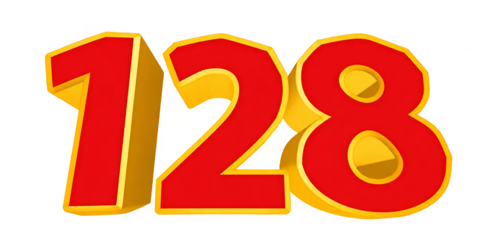

# Definitive Edition 128

DE128 is a Shadow Fight 2 overhaul built as a mod for [Project Eclipse](https://github.com/dawc17/ProjectEclipse). This repository holds the mod: its Lua scripts and its assets.

It adds the young Sensei story, the full Underworld and the post-Titan Challengers, and brings back moves, music and equipment from older versions of the game. The shop is opened up, mythical sets are sold as chests, the forge is instant and lets you pick your enchantment, and boss abilities can be earned and equipped. Ads, paid offers and online services are gone.

## Running it

You need a current build of Project Eclipse. Copy the `de128` folder into Eclipse's `Mods` folder, keeping its name. Then open **Mods** on the title screen, tick **Definitive Edition 128** and choose **Apply & Restart**. DE128 keeps its saves separate from unmodded ones.

## Status

Still in development and not released yet. Expect balance to move around.

---

Unofficial fan project, not affiliated with or endorsed by Nekki. Shadow Fight is a trademark of Nekki.
